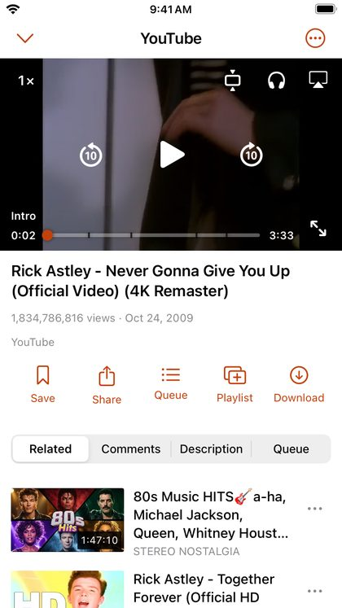
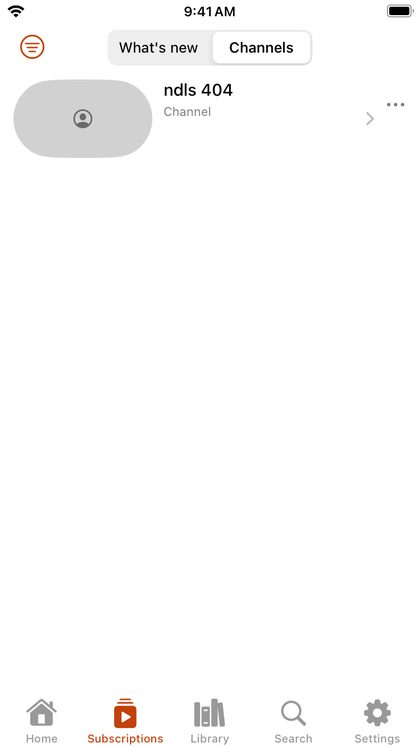
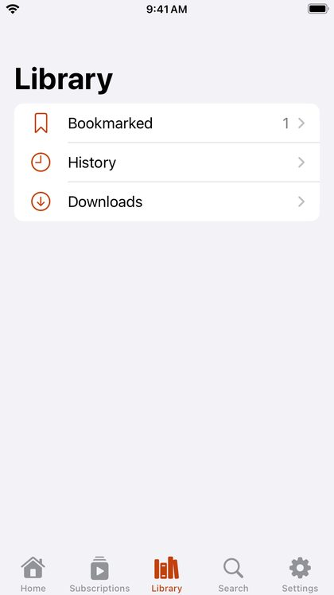

# DriftLoom

A free YouTube and SoundCloud client for **iPhone, iPad and Android**, with no ads, no tracking and no account.
DriftLoom is a fork of [NewPipe](https://github.com/TeamNewPipe/NewPipe): the Android app is NewPipe 0.29.1
rebranded and patched, and the iOS app is a native SwiftUI app written to work the way NewPipe does.

<p>
  
  
  
  
</p>

## Features

- Search YouTube and SoundCloud with filters; browse channels, playlists, Mixes, trending, live, music charts and podcasts.
- Subscribe without an account, with groups, a combined **What's new** feed and optional new-video notifications.
- Background audio, Picture in Picture, audio-only mode, chapters, subtitles, speed, resolution limits and up to 4K
  where the device decodes it.
- Queues, autoplay, history, saved videos and local playlists that stay on your device.
- Downloads for offline playback, with subtitles, Wi-Fi-only by default.
- Import subscriptions from NewPipe backups or Google Takeout; back up and restore your library.
- Opens YouTube and SoundCloud links from the share sheet.
- English, Ukrainian and Portuguese on iOS.

The [user guide](docs/user-guide/README.md) covers everything, and is also built into the iOS app
(**Settings → Help → User guide**).

## Install

**iPhone and iPad, iOS 15 or later.** DriftLoom isn't on the App Store: Apple doesn't allow apps that download
YouTube videos. Download `DriftLoom-<version>.ipa` from [Releases](https://github.com/sk3llo/DriftLoom/releases)
and install it with AltStore, SideStore or Sideloadly. With a free Apple ID the app has to be refreshed every 7 days.
**[Step-by-step install guide](docs/install-ios.md).**

**Android 6.0 or later.** Download `DriftLoom-<version>.apk` from [Releases](https://github.com/sk3llo/DriftLoom/releases)
and open it to install. DriftLoom installs alongside NewPipe; it can't update NewPipe or be updated by it.

## Build

**iOS:** Xcode 26.6 or newer. Open `iosApp/iosApp.xcodeproj`, choose the `iosApp` scheme and your device, set your
team under *Signing & Capabilities*, and run. No Gradle, Java or Android SDK needed.

```sh
swift test --package-path iosApp/Playback
```

**Android:** JDK 21 and the Android SDK.

```sh
./gradlew :app:assembleDebug --no-configuration-cache
```

Testing, smoke checks, device verification and the implementation record are in
[docs/development.md](docs/development.md).

## Problems and ideas

Use **Report** on an error, or **Settings → Help → Report a problem**, to open a GitHub issue with the details filled
in. Nothing is sent until you submit it. You can also [open an issue](https://github.com/sk3llo/DriftLoom/issues/new/choose)
directly. Contributions are welcome: see [CONTRIBUTING](.github/CONTRIBUTING.md).

YouTube sometimes blocks networks with "confirm you're not a bot". DriftLoom tells you when that happens and doesn't
try to get around it; see [Troubleshooting](docs/user-guide/troubleshooting.md).

## Privacy

No account, no analytics, no DriftLoom server. The app talks directly to YouTube and SoundCloud, and your library
stays on your device. See [PRIVACY.md](PRIVACY.md).

## License and attribution

Licensed under [GPL-3.0-or-later](LICENSE). DriftLoom is an independent fork of NewPipe and isn't an official
Team NewPipe release; please don't report DriftLoom problems to them. The upstream Git history, contributor
copyright notices and artwork are kept. The iOS app uses [YouTubeKit](https://github.com/alexeichhorn/YouTubeKit)
(MIT) for stream extraction.
