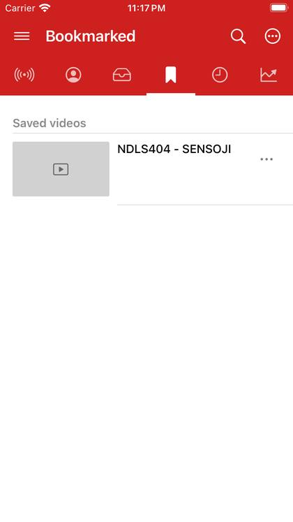

# About DriftLoom

DriftLoom is a private, ad-free way to watch YouTube and listen to SoundCloud on iPhone and iPad. It is an independent iOS version of NewPipe: there is no account to sign in to, and your subscriptions, playlists and history stay on your device.

## What you can do

- **Watch and listen** to YouTube videos, live streams and SoundCloud tracks, in the app or in Picture in Picture.
- **Search** YouTube and SoundCloud, with filters, suggestions and results in the language you type.
- **Subscribe** to channels without a Google account, and see their new uploads in *What's new*.
- **Save** videos, make your own playlists and bookmark online ones.
- **Download** videos and audio to watch offline.
- **Listen with the screen off**, with audio only and background playback.
- **Bring your library over** from NewPipe or from YouTube with Google Takeout.

## Your data stays with you

DriftLoom talks to YouTube and SoundCloud directly. Your library is stored on the iPhone, and you can back it up to a file at any time. See [Backup and import](backup-and-import.md).

DriftLoom works on iPhone and iPad with iOS 15 or later, in English, Ukrainian and Portuguese.
