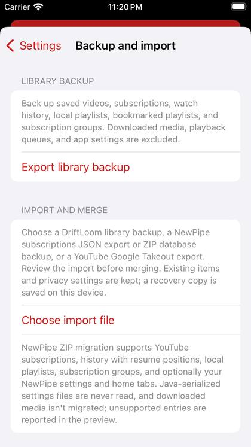

# Backup and import

Open **Settings → Backup and import**.

## Back up your library

**Export library backup** saves your saved videos, subscriptions, watch history, local playlists, bookmarked playlists and subscription groups to a file, for example in iCloud Drive. Downloads, the queue and settings aren't included.

## Import

**Choose import file** accepts:

- a **DriftLoom backup**;
- a **NewPipe** subscriptions export (JSON) or a NewPipe backup (ZIP), including history with resume positions, playlists, groups and, if you choose, NewPipe's settings and home tabs;
- a **Google Takeout** export of your YouTube subscriptions.

DriftLoom shows what it will import before anything changes. **Merge imported library** adds it to what you have; nothing you already have is removed, and a recovery copy is kept on the iPhone.

## From YouTube with Google Takeout

1. Tap **Open Google Takeout** and sign in with your Google account.
2. Under *YouTube*, choose *All YouTube data included*, select only *subscriptions*, and create the export.
3. Download the ZIP and choose it with **Choose import file**.

Only subscriptions come over from Takeout. DriftLoom never sees your Google account.
