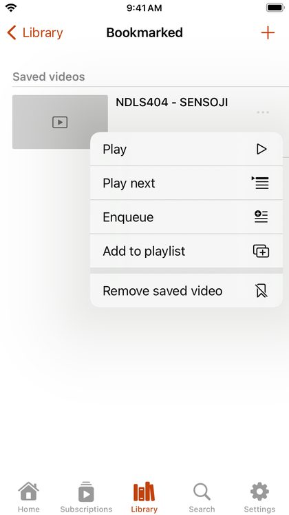

# Channels and playlists

## Channel pages

Tap a channel's name under a video, or a channel in search results. Its page shows the channel's videos, shorts, live streams and playlists in tabs. **Play all** plays the list, **Enqueue** adds it to your queue, and **Subscribe** follows the channel.

## The ⋯ menu

Every video, channel and playlist in a list has a **⋯** button with what you can do with it.

- **Play**, **Play next** or **Enqueue** (add to the end of the queue).
- **Add to playlist**: one of your own playlists, or a new one.
- **Open channel**, **Subscribe** or **Unsubscribe**.
- **Save video** or **Remove saved video**.
- **Bookmark playlist** for an online playlist, and **Add to home** to pin a channel or playlist as a home tab.

## Your own playlists

Make a playlist with **Add to playlist → Create a playlist** in a video's **⋯** menu, or **Playlist** in the player. Open a playlist to play it, reorder it, rename it, delete it, or add it to Home. See [Saved videos, playlists and history](saved-and-history.md).
