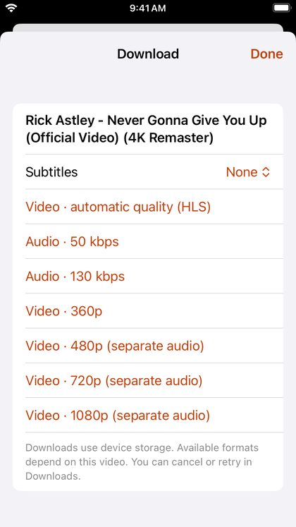
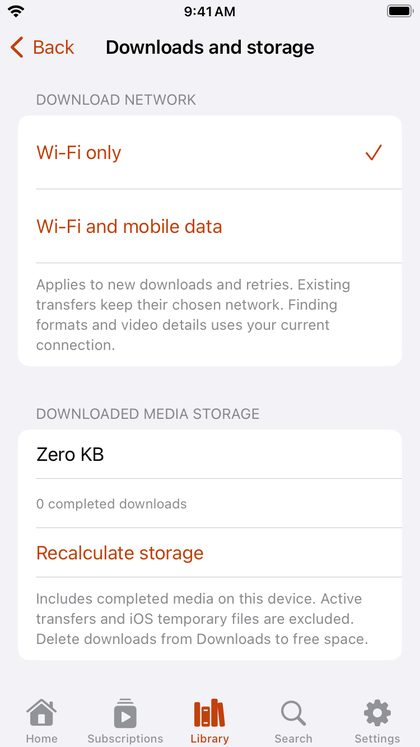

# Downloads

## Download a video

In the player, tap **Download** in the row of buttons under the title. Pick a format: *Video · automatic quality (HLS)* is right for most videos; other choices include a fixed resolution or audio only. You can also save subtitles in a language you choose.

Downloads continue in the background. Their progress shows in a strip above the tab bar, as notifications, and (on iOS 16.1 and later) on the Lock Screen and in the Dynamic Island.

## Your downloads

Open **Library → Downloads**, or tap the progress strip. From there you can **Play offline**, **Cancel download**, **Retry download** after a problem, or swipe left to **Delete** a download from the iPhone.

## Wi-Fi only

**Downloads and storage** (in Downloads, or **Settings → Downloads**) chooses whether new downloads use **Wi-Fi only** or **Wi-Fi and mobile data**, and shows how much space downloads take.
