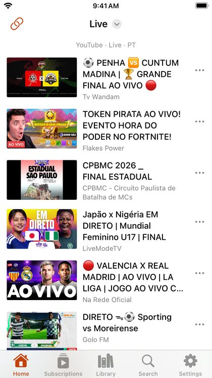

# First steps

When DriftLoom opens you are on **Home**. The tab bar at the bottom switches between Home, Subscriptions, Library, Search and Settings.

## Watch something

1. Tap **Search** in the tab bar and type what you are looking for.
2. Tap a video in the results. It opens in the player.
3. Swipe the player down, or tap the arrow at its top left, to keep watching in the small bar above the tab bar while you browse.

## Follow a channel

Open a channel from a video or from search and tap **Subscribe**. Its new uploads appear under **Subscriptions → What's new**. See [Subscriptions and What's new](subscriptions.md).

## Find your way around

- **Home** shows live videos to start with. Tap its title to switch to Trending music and other sections; see [Home and the tab bar](home-and-menu.md).
- **Subscriptions** has new videos from your channels (**What's new**) and the channels themselves (**Channels**).
- **Library** keeps your bookmarks and playlists, watch history and downloads.
- **Settings** has every option, the user guide and About.

## Where to go next

- [The player](player.md): controls, gestures, chapters and full screen.
- [Settings](settings.md): every option in one place.
- [Language and region](languages-and-regions.md): change the app's language, or which country YouTube shows you.
