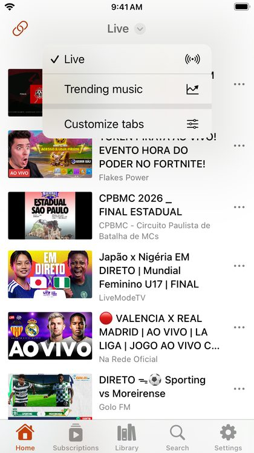

# Home and the tab bar

## The tab bar

The bar at the bottom of the screen has five tabs:

- **Home**: live videos, charts and the other sections you choose, plus channels and playlists you pinned.
- **Subscriptions**: new videos from the channels you follow, and the channels themselves.
- **Library**: Bookmarked, History and Downloads.
- **Search**: YouTube and SoundCloud.
- **Settings**: every option, the user guide and About.

When a video is playing, the small player sits just above the tab bar on every tab. Tap a tab you are already on to go back to its first page.

## Switch what Home shows

Tap the title at the top of Home (it has a small arrow next to it) to choose another section: Live, Trending music, Gaming, Podcasts, Movie trailers, SoundCloud trending, or a channel or playlist you pinned. The title always names the section you are looking at.

The **link** button at the top left opens a YouTube or SoundCloud link you paste; see [Opening links](opening-links.md).

## Customize Home

Choose **Customize tabs** at the bottom of the title menu. You can also find it in **Settings → Home tabs**.

- **Turn a section on or off** with its switch under *Show on home*.
- **Reorder** sections by dragging the handle on the right of each row. The title menu follows this order, and Home opens on the first one.
- **Remove a pinned channel or playlist** by swiping it to the left.

To pin a channel or online playlist, open its **⋯** menu anywhere in the app and choose **Add to home**. For your own playlists, use **Add to home** in the playlist's options.
