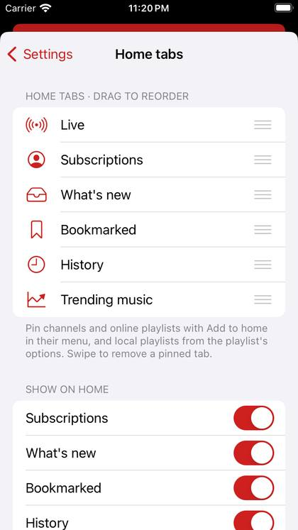
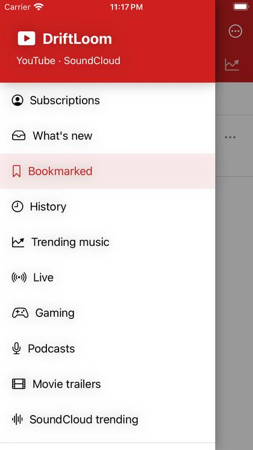

# Home, tabs and the menu

## The tab bar

Each icon under the red bar is a home tab. Tap one to open it; the bar's title shows its name. When you have more tabs than fit, the row scrolls sideways.

Tabs can be built-in sections (Live, Subscriptions, What's new, Bookmarked, History, Trending music, Gaming, Podcasts, Movie trailers, SoundCloud trending), channels and online playlists you pinned, and your own local playlists.

## Customize your tabs

Open **Customize tabs** from the three dots at the top right, or touch and hold the tab bar. You can also find it in **Settings → Home tabs**.

- **Turn a section on or off** with its switch under *Show on home*.
- **Reorder** tabs by dragging the handle on the right of each row.
- **Remove a pinned tab** by swiping it to the left.

To pin a channel or online playlist, open its **⋯** menu anywhere in the app and choose **Add to home**. For your own playlists, use **Add to home** in the playlist's options.

## The main menu

Tap the **three lines** at the top left, or drag in from the left edge of the screen. Drag it back to the left, or tap outside it, to close it.

The menu lists every home section (choosing one adds it to your tabs), your pinned channels and playlists, and Search, Open a link, Downloads, Settings and About.
