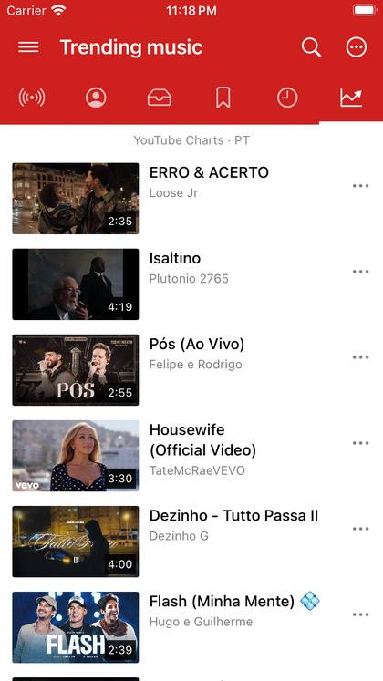

# Live, gaming and charts

DriftLoom brings YouTube's own curated pages to your home tabs:

- **Live**: live streams right now.
- **Gaming**: gaming videos and streams.
- **Podcasts**: podcast episodes.
- **Trending music**: YouTube's official music chart.
- **Movie trailers**: trending trailers.
- **SoundCloud trending**: popular tracks on SoundCloud.

Live, Trending music and the others are on Home by default; add the rest from the menu or from [Customize tabs](home-and-menu.md).

## Change the country

These pages follow **Settings → YouTube content → Content region** (and *Content language*). The line at the top of the page names the region it shows, for example *YouTube · Live · UA*. See [Language and region](languages-and-regions.md).
