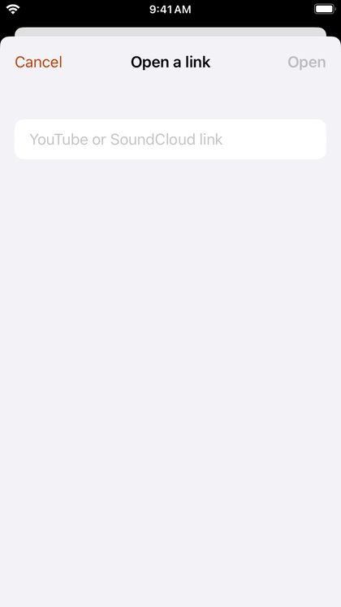

# Opening links from other apps

## From the share sheet

In Safari, the YouTube app, SoundCloud or any app that shares links, tap **Share** and choose **DriftLoom**. Videos and tracks start playing; channels, profiles and playlists open as a page. If DriftLoom isn't in the first row of the share sheet, tap **More** and add it.

## Paste a link

Tap the **link** button at the top left of Home, paste a YouTube or SoundCloud link and tap **Open**. You can also paste a link into the search field.

## Shortcuts and other apps

DriftLoom opens links of the form `driftloom://open?url=` followed by a YouTube or SoundCloud link, which you can use in the Shortcuts app.
