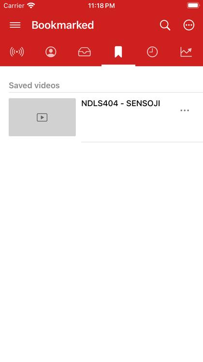

# Saved videos, playlists and history

## Bookmarked

The **Bookmarked** tab has three lists:

- **Local playlists**: playlists you made in DriftLoom. To make one, choose **Add to playlist** in any video's **⋯** menu (or **Playlist** in the player) and then **Create a playlist**.
- **Bookmarked playlists**: online YouTube or SoundCloud playlists you bookmarked.
- **Saved videos**: videos you saved with **Save** in the player or the **⋯** menu.

## Your own playlists

Open a playlist to play it (**Play all**) or add it to the queue (**Enqueue**). Its options let you **Rename** it, **Delete** it, or **Add to home** as a tab. Swipe a video left to remove it from the playlist.

## History

The **History** tab lists what you have watched, most recent first. Swipe a video left to remove it, or tap the bin to clear the history.

To stop recording what you watch or search for, use **Settings → History**.
