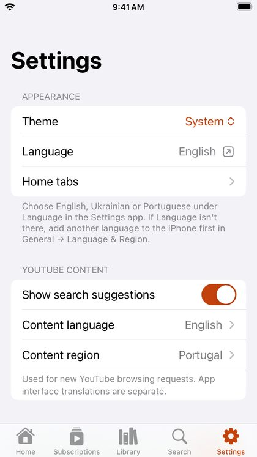

# Settings

Tap **Settings** in the tab bar.

## Appearance

- **Theme**: System, Light or Dark.
- **Language**: the app's language; opens DriftLoom in the iPhone's Settings app. See [Language and region](languages-and-regions.md).
- **Home tabs**: which tabs Home shows, and their order. See [Home and the tab bar](home-and-menu.md).

## YouTube content

- **Show search suggestions** while you type.
- **Content language** and **Content region**: which country's Live, Gaming and trending pages you see, and the language YouTube uses where it can.

## History

- **Record watch history** and **Record search history** on or off.
- **Clear watch history** and **Clear search history**.

## Playback

- **Resume playback position**: continue videos where you left off.
- **Autoplay related videos**: when the queue ends, play a related video.
- **Resolution on Wi-Fi** and **Resolution on mobile data**: the highest quality to use on each. A choice in the player's *Quality* menu changes only the current video.

## Notifications

- **New videos from subscriptions**: notifications for new uploads, checked in the background.

## Subtitles

- **Show subtitles in**: the language that turns on automatically, or *Off*.
- **Auto-translate when unavailable**: use YouTube's translation when there are no subtitles in that language.
- **Text size**: Small, Medium or Large.

## Downloads and your data

- **Downloads and storage**: Wi-Fi only or mobile data too, and the space downloads use. See [Downloads](downloads.md).
- **Backup and import**: back up your library, or bring it over from NewPipe or YouTube. See [Backup and import](backup-and-import.md).

## Help

- **User guide**: this guide.
