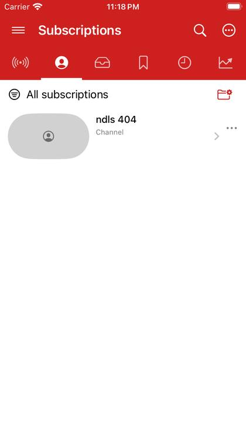

# Subscriptions and What's new

## Subscribe without an account

Tap **SUBSCRIBE** on a channel page or under a video, or choose **Subscribe** in a channel's **⋯** menu. The **Subscriptions** tab lists the channels you follow.

## What's new

The **What's new** tab collects recent uploads from your subscriptions, newest first. Pull down or tap the refresh button to check again. **Feed filters** limit it to the last 24 hours, 7 days or 30 days, and can hide videos you have watched.

## Subscription groups

Groups let you split your subscriptions, for example *Music* and *News*. Tap the folder button at the top right of Subscriptions to make and edit groups, and the name at the top left of Subscriptions or What's new to show one group at a time.

## New-video notifications

Turn on **Settings → Notifications → New videos from subscriptions** to be told about new uploads. DriftLoom checks in the background; iOS decides how often, based on how much you use the app, and *Background App Refresh* must be on for DriftLoom. Tapping a notification plays the video, or opens What's new for several.
